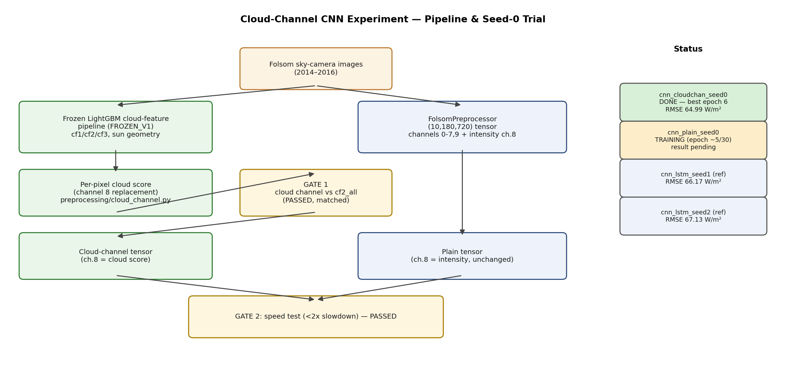

# Cloud-Channel CNN Experiment — Report (seed-0 trial)

**Status: IN PROGRESS.** Cloud-channel seed-0 is trained and tested. Plain seed-0 (the paired baseline, same seed/settings) is still training. This report will be updated once plain seed-0 finishes; until then, no conclusion about the cloud channel is drawn, per the one-seed caveat below.

## Pipeline

The `cloud-channel-cnn` branch adds a `--cloud-channel` flag to `scripts/train_gpu.py` / `scripts/evaluate_test.py`. It replaces the redundant intensity channel (index 8) of the `(10,180,720)` CNN input tensor with a per-pixel cloud score derived from the frozen LightGBM cloud-feature pipeline (`FROZEN_V1`), computed in `preprocessing/cloud_channel.py`. All other channels are untouched.

## Gates (run before training)

| Gate | Check | Result |
|---|---|---|
| Gate 1 | Cloud channel (ch. 8) agrees with the frozen extractor's `cf2_all` on real clear/cloudy images | **PASSED** — verified against `cloud_features.parquet` using measurable-pixel-only fractions; clear image diff 0.0017, cloudy image diff 0.0240 (tolerance 0.05) |
| Gate 2 | Cloud-channel training step is not >2x slower than plain | **PASSED** — both variants completed 50-batch smoke tests without error, comparable per-batch time |

Full numeric detail for both gates is logged in `experiments/cloud_channel_RUNLOG.md`.

## Runs

| Run | Seed | Cloud channel | Settings | Status |
|---|---|---|---|---|
| `cnn_cloudchan_seed0` | 0 | yes | batch=8, lr=1e-4, patience=5, GPU 1 | **DONE** |
| `cnn_plain_seed0` | 0 | no | batch=8, lr=1e-4, patience=5, GPU 1 | **training** (epoch ~5/30 as of this report) |
| `cnn_lstm_seed1` (reference only) | 1 | no | pre-existing run, different seed | done (not a paired comparison) |
| `cnn_lstm_seed2` (reference only) | 2 | no | pre-existing run, different seed | done (not a paired comparison) |

No existing run matched `cnn_plain_seed0`'s exact settings (seed 0, no cloud channel), so it had to be trained from scratch rather than reused.

## Results — 2016 test set (scored once, 224,022 samples)

| Run | Best epoch | GHI RMSE (W/m²) | GHI MAE (W/m²) | GHI R² | GHI nRMSE | k-index R² |
|---|---|---|---|---|---|---|
| `cnn_cloudchan_seed0` | 6 | **64.99** | 30.04 | 0.9462 | 0.1389 | 0.8287 |
| `cnn_plain_seed0` | — | pending | pending | pending | pending | pending |
| `cnn_lstm_seed1` (ref, seed 1) | 3 | 66.17 | 33.15 | 0.9443 | 0.1414 | 0.8235 |
| `cnn_lstm_seed2` (ref, seed 2) | 5 | 67.13 | 32.48 | 0.9426 | 0.1434 | 0.8200 |

**Seed spread among existing plain runs (seed 1 vs seed 2):** RMSE differs by 0.96 W/m² (66.17 vs 67.13) purely from random seed, with no architecture/input change.

**Cloud-channel vs. reference plain runs:** `cnn_cloudchan_seed0`'s RMSE (64.99) is 1.18 W/m² lower than seed 1 and 2.14 W/m² lower than seed 2 — both differences exceed the 0.96 W/m² seed-1-vs-seed-2 spread. This is a suggestive signal, **not evidence of improvement**: seed 1 and seed 2 are different seeds from cloud-channel seed 0, not a paired comparison, and the seed-0 plain run (the actual matched baseline) has not finished. The comparison that matters — `cnn_cloudchan_seed0` vs `cnn_plain_seed0`, same seed, same everything except the cloud channel — is still pending.

Training time for `cnn_cloudchan_seed0` to its best epoch (6): ~12.8 hours (46,103 s) of real training compute.

## Known issue (operational, does not affect result validity)

A bug in a newly-written watchdog script (`scripts/auto_train_watchdog_cloudchan.sh`, not an edit of any original file) caused `cnn_cloudchan_seed0` to keep restarting and retraining for ~35 extra hours after it had already legitimately early-stopped at epoch 11 (best = epoch 6). The script was copied from the wrong template and lacked exit-code / DONE-file handling. This was caught, the new scripts were fixed (adding exit-code checks and a DONE marker, ported from the project's correct `train_with_watchdog.sh` pattern), and `best_model.pt` was verified via direct checkpoint inspection to still correctly hold the epoch-6 weights (`val_loss=0.020462`) — the wasted epochs never overwrote it. No original project file was modified. Full root-cause detail is in `experiments/cloud_channel_RUNLOG.md`.

## Caveats

- **One seed is only a first look.** A single-seed comparison cannot prove the cloud channel improves forecasting — only a difference that clearly and consistently exceeds the seed-to-seed spread (currently 0.96 W/m² RMSE from seed 1 vs seed 2) across multiple seeds would support that claim.
- **Image-time matching** still uses the file-name clock for frame lookup, not the corrected image clock used internally by `cloud_features.parquet` (`t_img`) — a known limitation inherited from the existing pipeline, not introduced by this trial.
- 2016 was used strictly as a held-out test set, evaluated once per finished run, never used to pick settings.

## Next steps

1. Wait for `cnn_plain_seed0` training to finish (early stopping, patience 5).
2. Evaluate `cnn_plain_seed0` on 2016 with the same procedure (no `--cloud-channel` flag).
3. Update the results table above with the paired seed-0 comparison and revise the conclusion accordingly.
